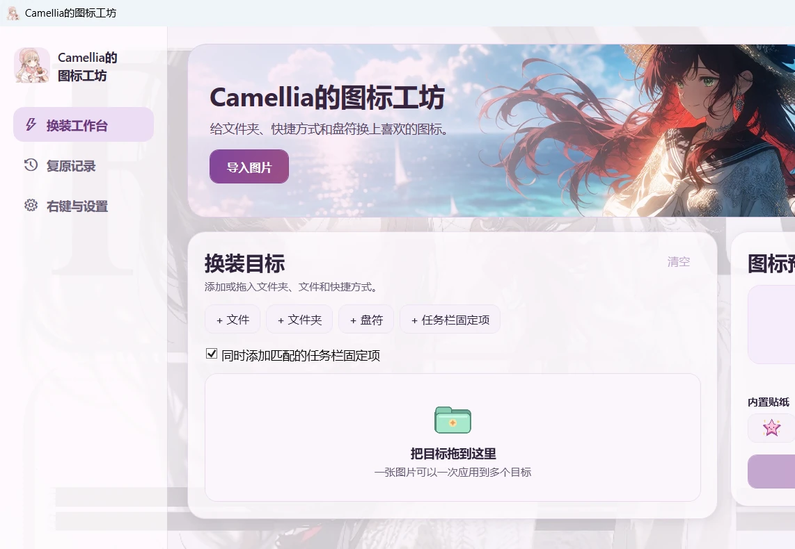
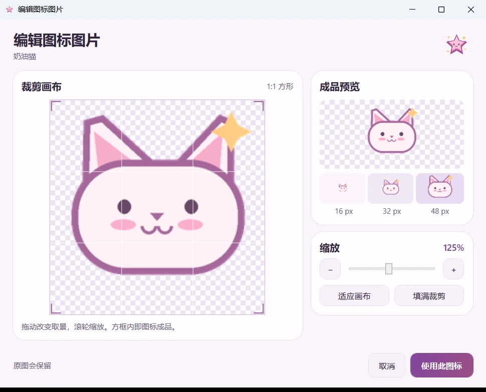

# Camellia的图标工坊

粉紫色的 Windows 图标换装工具。把文件、文件夹、快捷方式或盘符加入队列，导入一张图片或选一枚内置贴纸，一次应用到多个目标。每项换装都有复原记录。

[下载 Windows x64 便携版](https://github.com/Camellia-Garden/self-define-icon/releases/download/v1.3.0/Hanairo.exe) · [发布说明](https://github.com/Camellia-Garden/self-define-icon/releases/tag/v1.3.0)

## 怎么用

1. 双击 **Hanairo.exe**。便携版自带运行时。
2. 在「换装工作台」拖入目标，或使用「文件」「文件夹」「盘符」「任务栏固定项」添加。文件和文件夹都可以多选。
3. 点「导入图片」或拖一张图片到预览卡片。在编辑器中调整取景，确认「使用此图标」。也可以直接选一枚内置贴纸。
4. 点「应用到 N 个目标」。工房会生成带透明通道的多尺寸 ICO。
5. 在「复原记录」点对应项目的「复原」，或点「全部复原」。同一目标换装多次时，会恢复第一次换装前的配置。批量操作中的失败项可以在「查看结果」中查看原因。

在「右键与设置」启用右键菜单后，可从资源管理器的右键菜单选「更换图标 · Camellia的图标工坊」。Windows 11 的入口在「显示更多选项」。右键一次添加一个目标，多个目标可在工作台批量操作。启用后如果移动 EXE，请在新位置重新开启入口。

可导入 PNG、JPEG、ICO、BMP、GIF 和 TIFF。GIF 与多页 TIFF 使用第一帧，ICO 使用最大的帧。WebP 取决于系统是否有可用的图像解码器。

## 编辑图片

- 拖动图片调整方形取景。用滚轮、滑块或加减按钮放大缩小。画布获得焦点后也可以用方向键移动。
- 「适应画布」保留完整画面，空白处透明。「填满裁剪」按比例铺满画布并裁掉框外部分。
- 盘符图片也可以在「倒角修边」中调整圆角和透明留边。圆角范围为 0–50%，留边范围为 0–20%，会同步显示在裁剪画布和所有成品预览中，并写入最终 ICO。缩放与拖动时保留修边设置。
- 「重置修边」将圆角和留边归零。确认后可以再次编辑，取消会放弃本次更改。
- 右侧会同步显示大图和 16、32、48 像素的成品。点「使用此图标」后，可以从工作台的「编辑图片」返回继续调整。
- 图片在本机处理，原图保留。取消会放弃当前编辑。

## 支持范围

| 目标 | 应用与复原 |
| --- | --- |
| 文件夹 | 更新文件夹的图标配置。复原时恢复原始图标配置和应用改动的属性。 |
| 本地磁盘、可移动磁盘、RAM 盘 | 在当前 Windows 用户的注册表中设置单个盘符的图标。图标随盘符显示。 |
| 桌面和其他位置的 Windows 快捷方式 | 更换图标字段，保留启动目标、参数和应用分组信息。支持 .lnk 和 .url。 |
| 普通文件、直接运行的 EXE | 在同目录生成指向原文件的自定义快捷方式，复原时移除工房创建的副本。 |
| 任务栏的 Win32 固定快捷方式 | 按程序路径和参数唯一匹配时自动加入可见队列，也可手动选择。应用和复原时通知 Windows 刷新。 |

资源管理器导航窗格和任务栏会缓存图标，可以在工房左下角点「刷新系统图标」，或在资源管理器中按 F5。部分固定项可能需要取消固定后，再固定已经换好图标的快捷方式。运行中的第三方窗口、系统按钮、应用商店固定项和托盘图标由 Windows 或应用自己管理。参考 [Windows 文件夹自定义文档](https://learn.microsoft.com/en-us/windows/win32/shell/how-to-customize-folders-with-desktop-ini) 和 [任务栏图标规则](https://learn.microsoft.com/en-us/windows/win32/properties/props-system-appusermodel-relaunchiconresource)。

换装资产和复原记录在 %LOCALAPPDATA%\Hanairo。复原前请保留该目录及目标路径。如果有人在工房之外修改了同一目标的图标配置，工房会保留当前内容与复原记录，并报告冲突。卸载时可先全部复原，再关闭右键菜单。

## 进度与验收

- **v1.3.0** · 使用用户提供的插画作为整页半透明壁纸。参考 `E:\\wyfx\\api-test` 的背景图、半透明层和面板层次，加入柔和色罩、透明侧栏、半透明卡片和阴影，让壁纸在滚动、换装目标和预览区域后方保持可见。Windows 11 实测窗口和内容正常显示。
- **v1.2.0** · 应用更名为「Camellia的图标工坊」，应用图标采用用户提供图片的透明主体。新增圆角和透明留边。已验证修边参数的保存、取消和重置，预览与 ICO 帧在同一颜色格式下像素一致，修边后的临时盘符图标可被 Windows 读取并正常复原。
- **v1.1.0** · 已加入应用内裁剪、平移、缩放和多尺寸成品预览。Windows 11 实测通过横图导入和填满裁剪、取消编辑、保存后继续编辑、应用到测试文件夹和复原。自动检查核对了裁剪取景、透明留白和预览与 ICO 对应帧的像素。
- **v1.0.0** · 已完成工作台、图片导入、批量换装、逐项与全部复原、右键入口、盘符设置和任务栏固定快捷方式管理。
- **Windows 11 x64 实测** · 便携版可直接运行。通过了多尺寸 ICO 生成与重新导入、文件夹和临时盘符的 Windows 图标读取、普通文件快捷方式创建与撤销、本地及网络快捷方式的换装与复原、重启后复原及外部修改检测。
- **界面实测** · 右键菜单注册和撤销、启动参数传给已打开的工房、贴纸选择、两个目标一起换装、逐项及全部复原通过。也验证了加密 AppData 中断记录的恢复。
- **任务栏实测** · 已验证能识别现有 Win32 固定快捷方式，并将匹配项加入换装队列。换装与复原用临时测试目标验证，实际固定项在任务栏上的即时显示仍取决于 Windows 的分组与缓存。
- **发布** · Windows x64 便携版由 GitHub Releases 分发。发布说明提供构建的 SHA-256。

## 从源码运行和打包

在 Windows 安装 .NET 10 SDK 后，从仓库根目录执行

~~~powershell
dotnet run --project src/Hanairo/Hanairo.csproj
~~~

打包 Windows x64 单文件 EXE

~~~powershell
dotnet publish src/Hanairo/Hanairo.csproj -c Release -r win-x64 --self-contained true -p:PublishSingleFile=true -p:IncludeNativeLibrariesForSelfExtract=true -p:EnableCompressionInSingleFile=true -p:DebugType=None -o dist
~~~

生成文件位于 dist/Hanairo.exe。可用以下命令运行临时目录中的集成检查

~~~powershell
$check = Join-Path $env:TEMP ("Hanairo-check-" + [guid]::NewGuid().ToString("N"))
$test = Start-Process -FilePath .\dist\Hanairo.exe -ArgumentList ('--self-test "{0}"' -f $check) -WindowStyle Hidden -Wait -PassThru
Get-Content (Join-Path $check 'self-test.txt') -Encoding UTF8
$test.ExitCode
~~~

主界面的二次元插画由内置图像生成工具制作，绘制的是在樱花季文具店举起发光粉色星星的店员。内置贴纸随应用打包。

应用图标使用用户提供的参考图，经内置图像编辑工具移除白色背景并裁取人物与甜点主体。透明素材位于 [app-logo.png](src/Hanairo/Assets/app-logo.png)，多尺寸 Windows 图标位于 [Hanairo.ico](src/Hanairo/Assets/Hanairo.ico)。图像编辑要求为保留人物与甜点的外观、去掉白底及气泡装饰、输出透明背景。

便携包文件名沿用 Hanairo.exe。升级时可关闭旧版后在原位置替换；已开启的右键菜单可在设置中关闭再开启以更新显示名称。

工作台壁纸素材位于 [wallpaper.jpg](src/Hanairo/Assets/wallpaper.jpg)，应用通过半透明色罩和半透明面板叠加使用，原图不会被修改。
